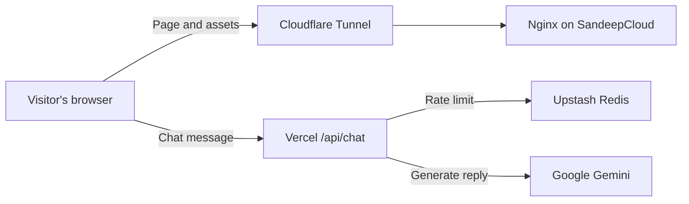

<div align="center">

# Sandeep Pokharel | Personal Portfolio

I work as an IT Support Desk Technician at Dakota State University, where I study Cyber Operations. Outside the help desk, I build tools for problems I run into at work and run a homelab on my laptop.

**[Visit the portfolio](https://portfolio.sandeeppokharel.com.np/)** · [Explore the homelab](https://portfolio.sandeeppokharel.com.np/#homelab) · [Browse projects](https://portfolio.sandeeppokharel.com.np/#projects)

[](https://github.com/pokharelsandeep333-commits/Portfolio/actions/workflows/deploy.yml)


</div>

## Inside the portfolio

- **Trace a backup.** Open **Homelab → Backups** and select **Cloudflare R2**. The map shows why I keep a nightly copy off the laptop as well as a weekly local copy. Switch to **Security events** to follow a different route through Wazuh.
- **Ask about the work.** Open **Chat with Digital Sandeep** and ask “Why did you build ShiftSentry?” The AI assistant builds its answers from the same project and experience records the site uses.
- **Take a one-page resume.** Open **Resume** and use the print control to save a PDF with selectable text. Project entries carry separate web and resume copy, so a project walkthrough can be detailed and its resume entry can stay short.

## Selected projects

| Project | What I built |
| --- | --- |
| [ShiftSentry](https://github.com/pokharelsandeep333-commits/ShiftSentry) | A shift planner I built while juggling campus jobs. It combines scheduled and worked hours so I can see whether another shift would put me over my weekly cap. |
| [DQA Automation Suite](https://github.com/pokharelsandeep333-commits/DQA-Automation) | A PowerShell and WPF tool for laptop inspections at the DSU help desk. It reads serial numbers, battery stats, and storage details through WMI/CIM to save technicians from typing them by hand. |
| [Home SOC Lab](https://github.com/pokharelsandeep333-commits/wazuh-home-soc) | A Wazuh setup with custom detection rules for my servers and AWS account. The repository includes test events I replay to check that the rules still alert. |
| [Private RAG Search Engine](https://github.com/pokharelsandeep333-commits/Molecular-Zettelkasten) | A search tool for my Obsidian notes. It matches a question against local embeddings and sends the matching notes to Gemini to answer it. |

## How a request reaches the site



**The page.** Vite builds the React site into static files. Nginx serves them from a Docker container on my Ubuntu Hyper-V VM. Desktop visitors see a silent video loop that pauses off-screen. Phones load a WebP portrait and skip the video download.

**The chat.** The browser sends a message to a Vercel function. Upstash limits each IP to 10 requests per minute. Zod validates the conversation, and the handler forwards at most 16 recent messages with an 800-token output cap. Each request starts with **Gemini 4 Hydrogen**, then tries **3.8 Flash → 3.6 Flash → 3.5 Flash Lite** on upstream rate limits and other retryable failures. The first successful reply ends the chain. [Chat handler](api/chat.js) · [Fallback tests](api/chat.test.js)

## Run locally

Use a current Node.js 22 LTS release and npm. The portfolio, homelab map, and printable resume run locally without service credentials.

```sh
git clone https://github.com/pokharelsandeep333-commits/Portfolio.git
cd Portfolio
npm ci
npm run dev
```

Open [localhost:5173](http://localhost:5173). To exercise chat or contact submissions, configure the relevant integration below.

| Variable | Where it belongs | Purpose |
| --- | --- | --- |
| `VITE_API_URL` | Vite build environment, or local `.env.local` | Full URL of the chat endpoint. When omitted, the frontend calls `/api/chat` on its own origin. The plain Vite dev server serves the frontend. |
| `VITE_FORMSPREE_URL` | Vite build environment, or local `.env.local` | Public Formspree endpoint for contact submissions. |
| `GEMINI_API_KEY` | Vercel function environment | Authenticates server-side requests to Gemini. |
| `UPSTASH_REDIS_REST_URL`, `UPSTASH_REDIS_REST_TOKEN` | Vercel function environment | Connect the chat rate limiter to Redis. |
| `ALLOWED_ORIGINS` | Vercel function environment, optional | Comma-separated browser origins allowed to read cross-origin chat responses. |

To run the function locally, supply its server variables to `vercel dev`. Keep credentials out of `VITE_*` variables, which Vite embeds in the browser bundle. Updating the production Gemini key takes a Vercel redeploy. Changing the self-hosted frontend's API URL takes a new Docker build.

## Checks and delivery

```sh
npm run lint
npm test
npm run build
```

Pull requests run ESLint, a production dependency audit, Gitleaks, and Vitest. On `main`, GitHub Actions builds the Nginx image, runs a report-only Trivy scan, and pushes the scanned image to Docker Hub. Watchtower on SandeepCloud checks for an update every five minutes. Vercel deploys the chat function separately. [Release workflow](.github/workflows/deploy.yml) · [Weekly image scan](.github/workflows/scan-published-image.yml)

## Where to make a change

| To change | Start here |
| --- | --- |
| Bio, experience, education, or skills | [Profile data](src/data/skills.js) |
| Project cards, resume descriptions, or the project facts available to chat | [Project data](src/data/projects.js) |
| Homelab services and routes | [Map data](src/data/homelab.js) · [Map design notes](docs/homelab-map.md) |
| Resume layout or print styles | [Resume view](src/components/ResumeView.jsx) · [Stylesheet](src/index.css) |
| Chat behavior or model order | [Chat function](api/chat.js) · [Hosting decision](docs/adr/0001-vercel-serverless-for-ai-agent.md) |
