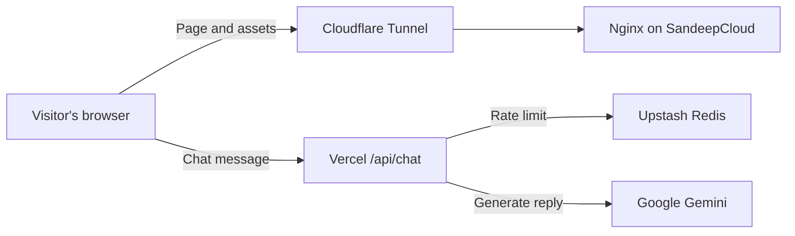

<div align="center">

# 🖥️ Sandeep Pokharel | Personal Portfolio

I study Cyber Operations at Dakota State University and work there as an IT Support Desk Technician. I wrote a tool for the laptops we inspect at the help desk. My own laptop hosts this site.

<h3><a href="https://portfolio.sandeeppokharel.com.np/">View Live Site »</a></h3>

[](https://github.com/pokharelsandeep333-commits/Portfolio/actions/workflows/deploy.yml)


</div>

## 🧭 Inside the portfolio

- In **Homelab → Backups**, select **Cloudflare R2**. My weekly backup lives on the same laptop as the VM. The nightly copy in R2 is the one I can restore if I lose the laptop. Select **Security events** to trace alerts through Wazuh.
- Ask **Digital Sandeep** “Why did you build ShiftSentry?” The assistant gets its project and experience details from the same files I edit for the site.
- Under **Resume**, choose **Download PDF** to save a one-page resume with selectable text. Each project has room for a full walkthrough on the site and a shorter description on the resume.

## 🧰 Selected projects

| Project | What I built |
| --- | --- |
| 🛡️ [ShiftSentry](https://github.com/pokharelsandeep333-commits/ShiftSentry) | I needed to know whether I could pick up another campus shift. ShiftSentry adds my scheduled hours to the hours I've worked and checks the total against my weekly cap. |
| 💻 [DQA Automation Suite](https://github.com/pokharelsandeep333-commits/DQA-Automation) | We used to type serial numbers, battery stats, and storage details by hand. My PowerShell and WPF tool reads them through WMI/CIM when a technician starts a laptop inspection. |
| 🔎 [Home SOC Lab](https://github.com/pokharelsandeep333-commits/wazuh-home-soc) | I write Wazuh detection rules for my servers and AWS account. The repo includes the test events I replay to check that the rules still catch what they should. |
| 📚 [Private RAG Search Engine](https://github.com/pokharelsandeep333-commits/Molecular-Zettelkasten) | I can ask a question about my Obsidian vault. The app searches local embeddings for relevant notes and sends those notes to Gemini with my question. |

## 🗺️ How a request reaches the site



Vite builds the React site into static files. Nginx serves them from a Docker container on my Ubuntu Hyper-V VM. On desktop, the opening video plays silently and pauses when you scroll past it. Phones download a WebP portrait instead.

Chat runs on Vercel. The function uses Upstash to limit each IP to 10 requests per minute and Zod to check incoming messages. It sends Gemini up to 16 recent messages and caps each reply at 800 tokens.

The function tries Gemini 4 Hydrogen first. If Google rate-limits it or returns another retryable error, the function tries 3.8 Flash, then 3.6 Flash, then 3.5 Flash Lite. It returns the first successful reply. [Chat handler](api/chat.js) · [Fallback tests](api/chat.test.js)

## 🚀 Run locally

Use a current Node.js 22 LTS release and npm. The portfolio, homelab map, and printable resume run locally without service credentials.

```sh
git clone https://github.com/pokharelsandeep333-commits/Portfolio.git
cd Portfolio
npm ci
npm run dev
```

Open [localhost:5173](http://localhost:5173). To send a chat message, point the frontend at a running chat function. To send a contact form, set the Formspree URL.

| Variable | Where it belongs | Purpose |
| --- | --- | --- |
| `VITE_API_URL` | Vite build environment, or local `.env.local` | Full URL of the chat endpoint. Leave it unset to use `/api/chat` on the same origin. The Vite dev server runs only the frontend. |
| `VITE_FORMSPREE_URL` | Vite build environment, or local `.env.local` | Public Formspree endpoint for contact submissions. |
| `GEMINI_API_KEY` | Vercel function environment | Authenticates server-side requests to Gemini. |
| `UPSTASH_REDIS_REST_URL`, `UPSTASH_REDIS_REST_TOKEN` | Vercel function environment | Connect the chat rate limiter to Redis. |
| `ALLOWED_ORIGINS` | Vercel function environment, optional | Comma-separated browser origins allowed to read cross-origin chat responses. |

To run the function locally, supply its server variables to `vercel dev`. Keep credentials out of `VITE_*` variables, which Vite embeds in the browser bundle. Updating the production Gemini key takes a Vercel redeploy. Changing the self-hosted frontend's API URL takes a new Docker build.

## 🔄 Checks and deployment

```sh
npm run lint
npm test
npm run build
```

Pull requests run ESLint, a production dependency audit, Gitleaks, and Vitest. On `main`, GitHub Actions builds the Nginx image, runs a report-only Trivy scan, and pushes the scanned image to Docker Hub. Watchtower on SandeepCloud checks for an update every five minutes. Vercel deploys the chat function separately. [Release workflow](.github/workflows/deploy.yml) · [Weekly image scan](.github/workflows/scan-published-image.yml)

## 📁 Where to make a change

| To change | Start here |
| --- | --- |
| Bio, experience, education, or skills | [Profile data](src/data/skills.js) |
| Project cards, resume descriptions, or the project facts available to chat | [Project data](src/data/projects.js) |
| Homelab services and routes | [Map data](src/data/homelab.js) · [Map design notes](docs/homelab-map.md) |
| Resume layout or print styles | [Resume view](src/components/ResumeView.jsx) · [Stylesheet](src/index.css) |
| Chat behavior or model order | [Chat function](api/chat.js) · [Hosting decision](docs/adr/0001-vercel-serverless-for-ai-agent.md) |
